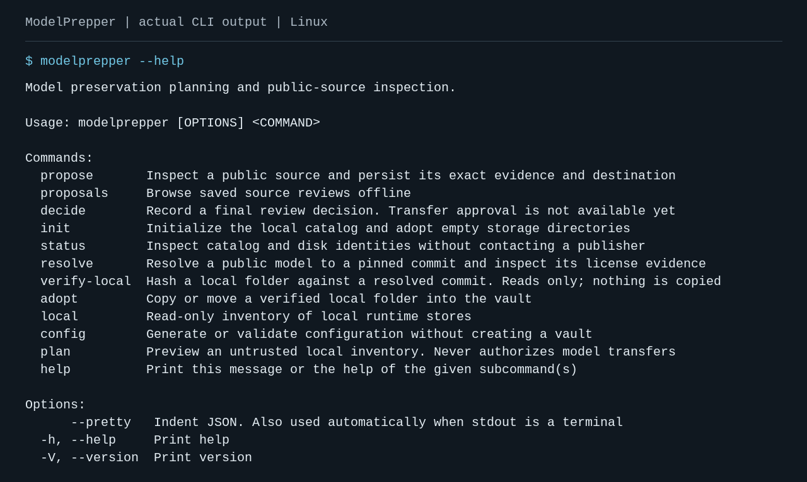
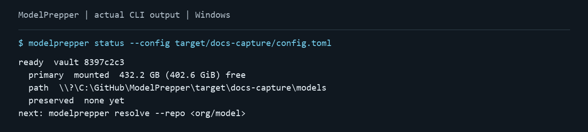

# ModelPrepper

**Keep the models you care about on disks you control.**

ModelPrepper is a native Rust utility being built for personal preservation of open-weight AI models. Its goal is complete, verified copies that remain inspectable when a publisher disappears, a host changes its terms, or access is restricted.

Local custody, portable data, and user control are central. The project rejects censorship and authoritarian concentration of AI access. Read the [project principles](intent.md) and [user experience plan](docs/user-experience.md).

## Project status

**Experimental prototype.** Vault setup, disk identities, offline status, public-source inspection, durable source reviews, and local inventory previews work today. `verify-local` and `adopt` can check a folder you already downloaded and store it as an upstream-verified local copy. The streaming transfer library is an experiment. Approved downloads, budget accounting, sealed bundles, replicas, and unattended maintenance are still being built. No current command downloads a model into the vault.

| Available now | Behavior |
| --- | --- |
| config init/check | Create configuration exclusively and validate its schema, policies, and non-overlapping paths. |
| init | Initialize bundled SQLite and adopt empty storage directories with stable disk identities. |
| status | Inspect catalog, disk identities, preserved copies, and actual free space without publisher access. |
| resolve | Pin a public commit and verify license, configuration, tokenizer configuration, and index evidence. GGUF-only repos are labeled `gguf-v1`. |
| propose / proposals / decide | Save exact source reviews, browse offline, and record rejection. Approval remains blocked. |
| verify-local / adopt | Compare a local folder with a resolved commit, then copy or move the matched file set. Absent optional files are excluded. |
| local list | Read Ollama manifests and say whether each tag was checked against the catalog. Nothing in the store is changed. |
| plan | Preview untrusted local inventory with selected files, costs, exclusions, and blockers. |

See [implementation status](docs/implementation-status.md) for observed evidence and limitations, and the [roadmap](docs/roadmap.md) for delivery gates.

## Get started

Build from source with the pinned Rust toolchain:

    git clone https://github.com/blisspixel/ModelPrepper.git
    cd ModelPrepper
    cargo build --locked --release

Rust is required to build. The resulting executable needs no Rust, Python, Node, Docker, database installation, inference server, or GPU to run. Platform qualification is tracked in CI and the release plan; production binary releases are not available yet.

PowerShell and shell installers are prepared for verified native releases and offline archives. A Windows preview tag is not a production release and is not what `latest` installs. See [installation](docs/installation.md) for the limits.

Create a configuration and initialize an empty vault:

    cargo run --locked --release -- config init --output config.local.toml --catalog catalog --volume models
    cargo run --locked --release -- config check --config config.local.toml
    cargo run --locked --release -- init --config config.local.toml
    cargo run --locked --release -- status --config config.local.toml

Relative storage paths resolve against the config file. Setup refuses unrelated files, overlapping directories, symlinks, and Windows reparse points. Repeating init retains disk identities. A missing or substituted disk is reported without being adopted.

Inspect a public model without downloading weights:

    cargo run --locked --release -- resolve --repo Qwen/Qwen2.5-0.5B-Instruct --revision main

Review the resolved commit and original license evidence. A license tag alone is insufficient. Source inspection always reports transfer_authorized=false. A terminal prints a short text verdict and one next step. A pipe, or `--json`, prints compact JSON; `--pretty` indents that JSON. `--json` also wins over `local list --format text`. Color is `--color auto|always|never`, and `NO_COLOR` or `TERM=dumb` turns it off. JSON is never colored. A missing repository is `repository_not_found_or_private` (Hugging Face uses HTTP 401 for both), and a missing revision is `revision_not_found`.

On a terminal, a failure is one `error:` line and one `next:` line. Piped failures stay a JSON object with `error.code` and `error.message`. Argument errors exit 2. Application errors exit 1. A closed pipe exits 0.

If you already have the files, verify them against that commit and adopt the folder. This is not a download, and it is not a local-baseline import. Every required file must match the resolved sizes and upstream hashes, and the commit must already have matched license evidence. An optional file that is simply absent is an exclusion: it is not copied and it is not sealed in the manifest. An optional file that is present and matches is kept. A damaged optional file still fails the check. Verification, copy, manifest, retry, and move cleanup use that same frozen set. The catalog then records provenance `upstream-verified (local source)`. A successful adopt prints a preservation receipt. A failed or partial adopt does not.

    cargo run --locked --release -- verify-local --repo Qwen/Qwen2.5-0.5B-Instruct --revision main --path ~/Downloads/qwen
    cargo run --locked --release -- adopt --config config.local.toml --plan <plan_id> --path ~/Downloads/qwen --copy

`verify-local --repo` resolves that commit from the publisher. `verify-local --config config.local.toml --plan <plan_id> --path ...` uses the saved review and does not contact the network. On a terminal, hashing progress is one line rewritten in place. A pipe prints at most one line per ten percent of each file, and `--quiet` prints none. `local list` reads Ollama tags only. Without `--config` the coverage is `not_checked`. With `--config` it reports `none_recorded`, `partially_recorded`, or `all_components_recorded`, plus matched and total distinct digests and the missing roles. That match is historical byte identity from the catalog. It is not a fresh hash, not proof the disk is mounted, and not proof the model runs offline. Disconnecting a disk does not erase a recorded match. The command never calls the Ollama API and never modifies blobs.

Try the offline planning fixture:

    cargo run --locked --release -- plan --config examples/config.toml --inventory tests/fixtures/inventory.json --available-bytes 500000000000

The synthetic fixture produces a 5,504-byte preview. Local metadata never authorizes a transfer. See [getting started](docs/getting-started.md) for paths, output, and common problems.

## Current CLI captures

These images render actual output captured from the current release executable. They show the prototype CLI, not a proposed dashboard. Source fingerprints and image checksums are validated by CI; [capture instructions](docs/screenshots.md) explain regeneration.

## Designed for independent custody

- One native implementation with no required hosted ModelPrepper account or telemetry.
- Explicit selection and budgets, with explainable plans and approval boundaries.
- Ordinary self-contained folders and documented manifests.
- Verified resumption, older revision retention, cold storage, reconstruction, and replicas.
- Separate evidence for byte integrity, provenance, and actual offline loading.

These are product requirements. [Current status](docs/implementation-status.md) distinguishes implemented behavior from planned work.

## Documentation

| Start here | Engineering and operation |
| --- | --- |
| [Getting started](docs/getting-started.md) | [Contracts and reason codes](docs/contracts.md) |
| [Native installation](docs/installation.md) | [Durable source reviews](docs/source-reviews.md) |
| [Current status](docs/implementation-status.md) | [Architecture](docs/architecture.md) |
| [Product plan](docs/product.md) | [Storage and recovery](docs/storage.md) |
| [User experience and quality of life](docs/user-experience.md) | [Preservation and offline readiness](docs/preservation.md) |
| [Personal archival policies](docs/archive-policy.md) | [Dependency-aware selection](docs/worries.md) |
| [Roadmap](docs/roadmap.md) | [Native transfer investigation](docs/transfer-spike.md) |
| [Project principles](intent.md) | [Dependencies and platform policy](docs/stack.md) |
| [Responsibilities and limits](docs/notice.md) | [Quality and CI gates](docs/quality.md) |
| [Contributing](CONTRIBUTING.md) | [Repository and release gates](docs/release.md) |

Additional design details: [durable staging experiment](docs/staging-journal.md), [model sources and mirrors](docs/model-sources.md), [interfaces](docs/interfaces.md), [watch/discovery priorities](docs/worries.md), and [related projects](docs/related-projects.md).

## License and disclaimer

Project code and documentation are [MIT licensed](LICENSE). Preserved models and third-party artifacts retain their own licenses and restrictions.

The software is provided as is, without warranty. The authors and copyright holders disclaim warranties and liability to the extent stated in the MIT license and permitted by applicable law. No guarantee is made about security, data retention, continued source access, model safety, legality, or fitness for a particular purpose.

You are responsible for authorized access, upstream rights, applicable laws, safe execution, and independent backups. A checksum does not establish that a model is safe or runnable. Project philosophy and automated license matching are not legal advice. Read the [full responsibilities and limits](docs/notice.md) before relying on the utility.
